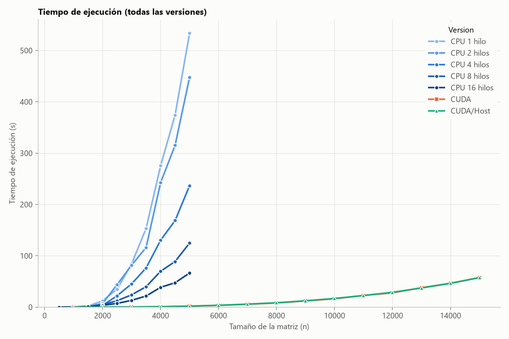
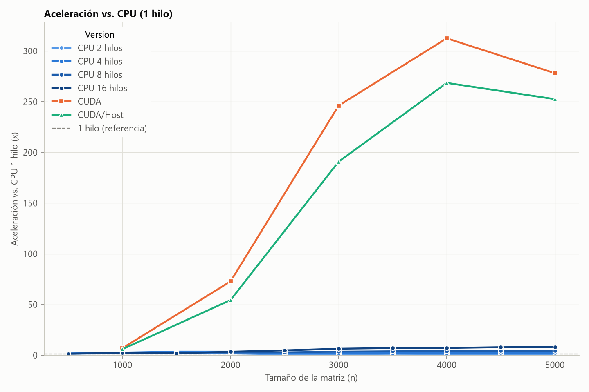
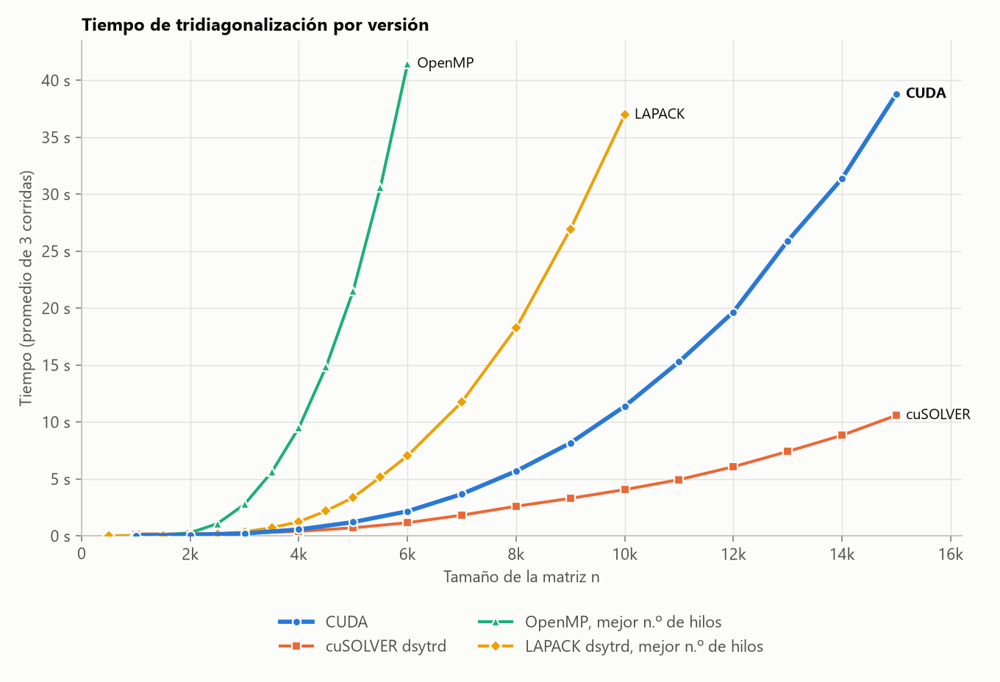
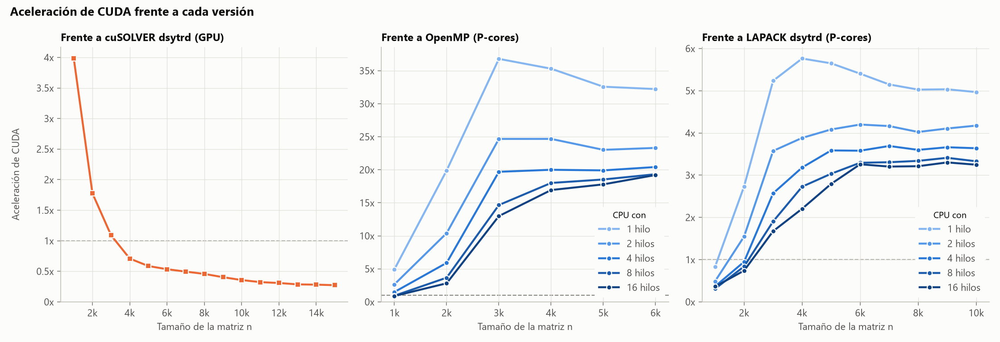
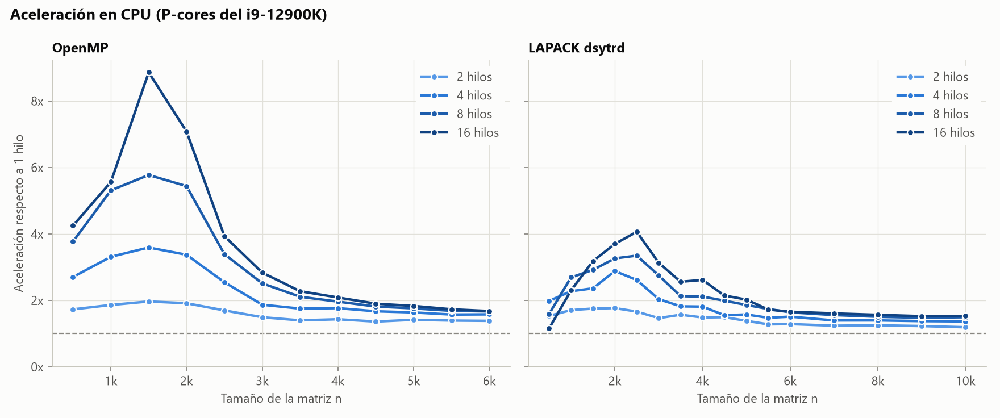

# Transformaciones de Householder en OpenMP y CUDA

Implementación y análisis de rendimiento de transformaciones ortogonales de **Householder** sobre matrices reales simétricas $A \in \mathbb{R}^{n \times n}$, paralelizadas en CPU multinúcleo (**OpenMP**) y GPU (**CUDA**).

El proyecto abarca tres etapas de reducción matricial:

1. **Triangularización superior (`triangulo/`)**: Reducción a forma triangular superior aplicando reflectores por la izquierda ($A \leftarrow H_k A$).
2. **Forma de Hessenberg (`hessenberg/`)**: Reducción dejando una subdiagonal no nula debajo de la diagonal principal.
3. **Tridiagonalización simétrica (`tridiagonal/`)**: Transformación por semejanza ortogonal $T = Q^T A Q$ ($A \leftarrow H_k A H_k$) explotando la simetría de $A$ mediante actualizaciones de rango 2.

---

## Estructura del proyecto

```text
.
├── triangulo/
│   ├── hh_superior.c               # Triangularización superior en CPU (OpenMP)
│   ├── hh_superior_cuda.cu         # Triangularización superior 100% en GPU (CUDA)
│   └── hh_superior_cuda_serial.cu  # Versión híbrida: vector Householder en CPU, actualización en GPU
├── hessenberg/
│   └── hessenberg.cu               # Reducción de Householder con desplazamiento subdiagonal en CUDA
├── tridiagonal/
│   ├── 3domp.c                     # Tridiagonalización simétrica en CPU (OpenMP)
│   ├── 3d.cu                       # Tridiagonalización simétrica en GPU (matriz completa)
│   ├── 3d_packed.cu                # Tridiagonalización en GPU con almacenamiento empaquetado (triángulo inferior)
│   └── 3d_cusolver.cu              # Referencia en GPU usando cuSOLVER (cusolverDnDsytrd)
├── resultados/
│   ├── hh_superior_results.csv       # Tiempos de triangularización en CPU (1 a 16 hilos)
│   ├── hh_superior_cuda_results.csv  # Tiempos de triangularización en CUDA y CUDA/Host
│   ├── 3d_results.csv                # Comparativa preliminar de tridiagonalización
│   └── 3d_opt_omp_results.csv        # Benchmark completo: CUDA, cuSOLVER, OpenMP y LAPACK (dsytrd)
└── graficas/
    ├── tiempo_todas_las_versiones.png
    ├── tiempo_cuda_vs_hibrido.png
    ├── aceleracion_todas_las_versiones.png
    ├── 3d_opt_tiempos.png
    ├── 3d_opt_aceleracion.png
    └── 3d_opt_escalabilidad.png
```

---

## Fundamento algorítmico

### 1. Reflector de Householder
Dado un vector columna $x$, se construye el reflector unitario $v$ que anula sus componentes debajo del índice pivote:

$$\alpha = -\operatorname{sgn}(x_0)\|x\|_2, \qquad u = x - \alpha e_0, \qquad v = \frac{u}{\|u\|_2}$$

Aprovechando la identidad $\|u\|_2^2 = 2\|x\|_2(\|x\|_2 + |x_0|)$, las versiones optimizadas de tridiagonalización calculan $\|u\|_2$ directamente sin requerir un segundo producto punto.

### 2. Triangularización superior ($A \leftarrow H_k A$)
En el paso $k$, el reflector $H_k = I - 2vv^T$ actualiza cada columna $A_{:,j}$ ($j \ge k$) mediante:

$$\delta_j = v^T A_{:,j}, \qquad A_{:,j} \leftarrow A_{:,j} - 2\delta_j v$$

### 3. Tridiagonalización simétrica ($A \leftarrow H_k A H_k$)
Para preservar los autovalores de una matriz simétrica $A$, la transformación se aplica por ambos lados sobre la submatriz activa $(k+1 \dots n-1)$:

$$p = A v, \qquad w = p - (v^T p)v, \qquad A \leftarrow A - 2(v w^T + w v^T)$$

- **`tridiagonal/3d.cu`**: Mantiene la matriz completa $n \times n$ en memoria global de la GPU y ejecuta 4 kernels por iteración (`householder_kernel`, `get_Av_kernel`, `get_w_kernel`, `matrix_substract_kernel`).
- **`tridiagonal/3d_packed.cu`**: Empaqueta únicamente el triángulo inferior ($\frac{n(n+1)}{2}$ elementos) por columnas, reduciendo a la mitad el consumo de memoria y dividiendo el producto $Av$ en lecturas por bloques de filas (`get_Av_rows_kernel`) y columnas (`get_Av_kernel`).

---

## Requisitos

- **Compilador C con OpenMP**: `gcc` (o compatible con `-fopenmp`).
- **NVIDIA CUDA Toolkit**: `nvcc`.
- **Librería `cuSOLVER` (`-lcusolver`)** para comparar

---

## Compilación

### Triangularización superior (`triangulo/`)

```bash
# OpenMP (CPU)
gcc -fopenmp triangulo/hh_superior.c -o hh_superior -lm

# CUDA (GPU)
nvcc triangulo/hh_superior_cuda.cu -o hh_superior_cuda

# Híbrido CUDA + Host
nvcc triangulo/hh_superior_cuda_serial.cu -o hh_superior_cuda_serial
```

### Forma de Hessenberg (`hessenberg/`)

```bash
nvcc -O3 -arch=native hessenberg/hessenberg.cu -o hessenberg
```

### Tridiagonalización simétrica (`tridiagonal/`)

```bash
# OpenMP (CPU)
gcc -fopenmp tridiagonal/3domp.c -o 3domp -lm

# CUDA (matriz completa)
nvcc tridiagonal/3d.cu -o 3d

# CUDA (triángulo inferior empaquetado)
nvcc tridiagonal/3d_packed.cu -o 3d_packed

# cuSOLVER (referencia con cusolverDnDsytrd)
nvcc tridiagonal/3d_cusolver.cu -o 3d_cusolver -lcusolver
```

---

## Uso

Todos los ejecutables generan una matriz simétrica aleatoria con semilla fija (`srand(500)`) para garantizar reproducibilidad, imprimen un resumen de la matriz resultante y reportan en la última línea el resultado en formato CSV:

```text
n,hilos_o_NT,tiempo_en_segundos
```

### Ejemplos de ejecución

```bash
# Triangularización en CPU con n = 4000 y 8 hilos OpenMP
./hh_superior 4000 8

# Triangularización en GPU con n = 4000
./hh_superior_cuda 4000

# Tridiagonalización en OpenMP: ./3domp <n> <hilos> <guardar_binarios: 0|1>
./3domp 2500 16 0

# Tridiagonalización en CUDA: ./3d <n> <guardar_binarios: 0|1>
./3d 5000 0
./3d_packed 5000 0
./3d_cusolver 5000 0
```

> **Nota:** En los programas de `tridiagonal/`, si el argumento `guardar_binarios` se omite o es `1`, se exportan la matriz original (`matlab/A.bin`) y la matriz tridiagonal resultante (`matlab/T.bin`) en formato binario `double` para validación numérica (simetría, traza, norma de Frobenius y conservación de autovalores).

---

## Resultados y gráficas

### Triangularización superior (`triangulo/`)

Comparativa entre la versión CPU con OpenMP (1, 2, 4, 8 y 16 hilos), la versión CUDA pura y la versión híbrida CUDA/Host:

| Tiempos de ejecución | Aceleración respecto a CPU (1 hilo) |
| :---: | :---: |
|  |  |

### Tridiagonalización simétrica (`tridiagonal/`)

Comparativa de tiempos y aceleración entre la implementación en CUDA, `cuSOLVER` (`dsytrd`), OpenMP y `LAPACK` (`dsytrd`):

| Tiempos de ejecución | Aceleración de CUDA |
| :---: | :---: |
|  |  |

| Escalabilidad en CPU (OpenMP vs LAPACK) |
| :---: |
|  |
